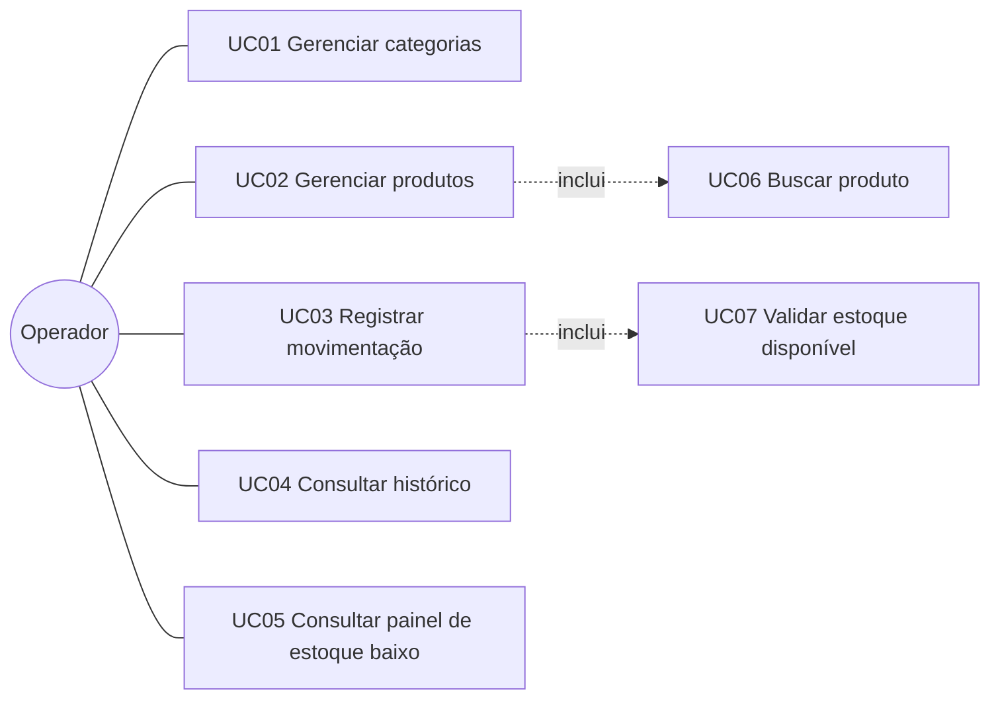

# 2. Casos de Uso

Ator: **Operador de estoque** (dono ou funcionário da loja).

## UC03 – Registrar movimentação
- **Pré-condição:** existe ao menos um produto cadastrado.
- **Fluxo principal:** 1) Operador abre "Movimentar"; 2) escolhe o produto; 3) escolhe Entrada ou Saída; 4) informa a quantidade (e observação opcional); 5) o sistema valida; 6) atualiza o estoque; 7) grava no histórico; 8) exibe mensagem de sucesso.
- **Fluxo alternativo A:** saída maior que o estoque → sistema exibe "Estoque insuficiente" e nada é alterado.
- **Fluxo alternativo B:** quantidade inválida (vazia, zero, negativa, texto) → mensagem de erro.
- **Pós-condição:** estoque atualizado e movimentação registrada.

## UC02 – Gerenciar produtos (resumo)
- **Fluxo principal:** listar → novo/editar → preencher formulário → validar → salvar.
- **Alternativos:** SKU duplicado, campo obrigatório vazio, preço inválido, categoria inexistente → mensagens de erro; exclusão pede confirmação.

## UC01 – Gerenciar categorias (resumo)
- Adicionar (nome único) e excluir (somente se não houver produtos).
