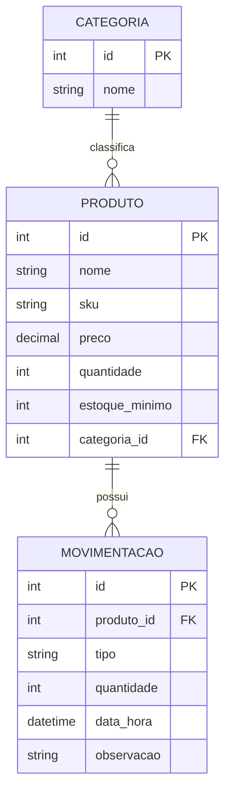

# 4. Modelo de Dados

## 4.1 Projeto Conceitual (DER)

## 4.2 Projeto Lógico Normalizado (esquemas de relação)
- CATEGORIA(**id**, nome)
- PRODUTO(**id**, nome, sku, preco, quantidade, estoque_minimo, *categoria_id*)
- MOVIMENTACAO(**id**, *produto_id*, tipo, quantidade, data_hora, observacao)

**Normalização**
- **1FN:** todos os atributos são atômicos, sem grupos repetitivos.
- **2FN:** todas as chaves primárias são simples (um só atributo), então não há dependência parcial.
- **3FN:** não há dependência transitiva; o nome da categoria fica só em CATEGORIA e é referenciado por chave estrangeira.

**Integridade:** PK em todas as tabelas; FK produto→categoria e movimentação→produto; UNIQUE em `categoria.nome` e `produto.sku`; CHECK para valores não negativos e para o tipo da movimentação.

## 4.3 Projeto Físico
Implementado em MySQL 8 no arquivo `database/schema.sql` (tipos, chaves, índices e restrições). Cada esquema de relação virou uma tabela, e o domínio de cada atributo foi reforçado por restrições CHECK, além do tipo de dado.
