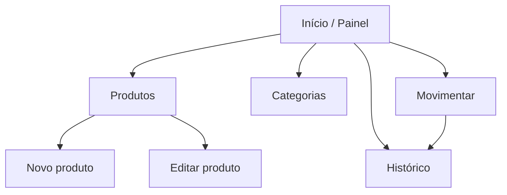

# 6. IHC – Telas, Mensagens e Mapa Conceitual

## 6.1 Princípios aplicados (conforme material teórico)
Clareza, consistência, simplicidade, controle do usuário, resposta imediata (feedback), ações reversíveis/confirmadas e estética agradável. Elementos comuns: botões, campos de texto, listas suspensas, menu de navegação e caixas de mensagem.

## 6.2 Mapa de navegação

## 6.3 Telas
| Tela | Elementos principais |
|---|---|
| Início | Total de produtos e tabela de produtos com estoque baixo |
| Produtos | Busca, botão "Novo produto", tabela com Editar/Excluir, destaque de estoque baixo |
| Novo/Editar produto | Campos nome, SKU, preço, quantidade, mínimo, categoria; botões Salvar e Cancelar |
| Categorias | Campo + botão Adicionar; tabela com Excluir |
| Movimentar | Produto, tipo (entrada/saída), quantidade, observação |
| Histórico | Tabela data/hora, produto, tipo, quantidade, observação |

## 6.4 Mensagens do sistema
| Situação | Mensagem | Tipo |
|---|---|---|
| Produto salvo | "Produto cadastrado com sucesso!" | Sucesso (verde) |
| Nome vazio | "O nome é obrigatório (mínimo de 2 caracteres)." | Erro (vermelho) |
| SKU repetido | "Já existe um produto com o código X." | Erro |
| Preço inválido | "O preço deve ser um número maior ou igual a zero (ex.: 12,50)." | Erro |
| Saída > estoque | "Estoque insuficiente: Produto possui apenas N unidade(s)." | Erro |
| Excluir categoria em uso | "Não é possível excluir: há produtos nesta categoria." | Erro |
| Excluir produto | Caixa de confirmação antes de excluir | Confirmação |
| Página inexistente | "Página ou registro não encontrado." (erro 404) | Erro |
